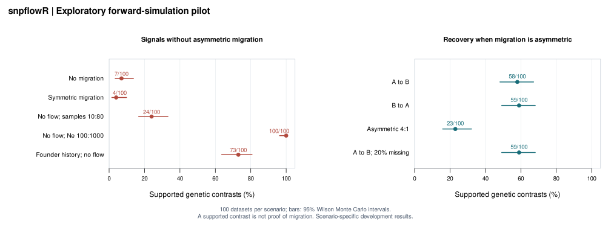

# Validation record

These are **exploratory development experiments**, not a confirmatory study,
external peer review, or evidence of universal migration-direction accuracy.
The scenarios, seeds, and negative results are retained. No empirical data were
used. The results reveal substantial demographic confounding, which blocks a
claim of reliable contemporary migration inference.

## 1. Computational tests

The [software verification record](SOFTWARE_CHECKS.md) links the passing
five-job GitHub check and retains the full local R package check report.



`tests/testthat/` checks independent two-allele heterozygosity arithmetic,
population reversal, allele relabeling, locus permutation, missing and fixed
loci, singular transforms, count validation, whole-block resampling, sample-name
alignment, compressed VCF input, partial missing calls, malformed genotypes,
simulator orientation, reproducibility, and plotting.

Duplicating a locus within the same block leaves the paired block-bootstrap
distribution unchanged when all blocks are duplicated equally. Treating those
copies as independent loci spuriously narrows intervals; the test checks this
distinction. Unit tests verify computation, not biological validity.

## 2. Forward simulation pilot

Reproduce after installing this repository's development version:

```sh
Rscript validation/run_pilot.R
```

The default is 100 independent datasets per scenario, 300 unlinked loci,
100 neutral drift-migration generations, and 999 paired locus resamples.
Mutation is zero. Both populations start from shared ancestral frequencies
with separate finite-population sampling, except the explicit founder scenario.
No positive MAF filter or post hoc rejection of unfavorable replicates is used.
See `pilot-scenarios.csv` for every parameter varied.

| Scenario | Supported | Correct direction | Wrong direction | False biological direction | Unresolved |
|---|---:|---:|---:|---:|---:|
| No migration | 7/100 | -- | -- | 7/100 | 93/100 |
| Symmetric migration | 4/100 | -- | -- | 4/100 | 96/100 |
| A to B | 58/100 | 58/100 | 0/100 | -- | 42/100 |
| B to A | 59/100 | 59/100 | 0/100 | -- | 41/100 |
| Asymmetric 4:1 | 23/100 | 23/100 | 0/100 | -- | 77/100 |
| No migration, sample sizes 10:80 | 24/100 | -- | -- | 24/100 | 76/100 |
| No migration, effective sizes 100:1000 | 100/100 | -- | -- | 100/100 | 0/100 |
| A to B, 20% missing calls | 59/100 | 59/100 | 0/100 | -- | 41/100 |
| Founder history, no subsequent migration | 73/100 | -- | -- | 73/100 | 27/100 |

"Supported" means the interval/reporting rule supports the **genetic contrast**.
Calling it a biological direction would yield the false calls shown above.
Different effective sizes or a founder history can change diversity without
ongoing migration. Unequal sampling also changes estimated rare/private alleles.
The bootstrap does not correct these effects.

With 100 datasets, Monte Carlo uncertainty is substantial. For example, 7/100
has a 95% Wilson interval of approximately 3.4%-13.7%; 100/100 has an interval
of approximately 96.3%-100%. Exact intervals for supported-call frequencies are
in `pilot-summary.csv`. These are not confidence intervals for migration rates.
No claim about genetic-estimand interval coverage is made by this pilot.

## 3. Independent coalescent pilot

The optional Python environment is used **only for research validation**, not
by the R package. It generates data with msprime instead of the bundled
forward simulator. Thirty independent 10 kb blocks contain within-block
recombination; the R analysis resamples whole blocks.

```sh
python -m venv .venv-validation
.venv-validation/bin/pip install -r validation/requirements-msprime.txt
.venv-validation/bin/python validation/generate_msprime.py
Rscript validation/analyse_msprime.R
```

On Windows, use the equivalent executables under `.venv-validation/Scripts/`.
Use the recorded Python version for closest reproducibility. The complete
resolved dependency list is in `results/msprime-environment.txt`.

The grid has 50 datasets per scenario, 40 sampled diploids per population,
effective sizes 1,000, and a split 1,000 generations ago. Ancestry follows the
Hudson coalescent; the mutation model is binary, with segregating sites retained.
Both mutation and recombination rates are 1e-8 per base per generation. The
backward msprime lineage-rate matrix reverses the forward migration labels.
Configuration, seeds, and version metadata are retained in the manifest and
protocol JSON.

| Scenario | Supported | Correct | Wrong | False biological direction | Unresolved |
|---|---:|---:|---:|---:|---:|
| No migration | 6/50 | -- | -- | 6/50 | 44/50 |
| Symmetric, rates 0.001 each | 4/50 | -- | -- | 4/50 | 46/50 |
| A to B, rate 0.002 | 27/50 | 27/50 | 0/50 | -- | 23/50 |
| B to A, rate 0.002 | 22/50 | 22/50 | 0/50 | -- | 28/50 |

An independent Python implementation computes two-allele heterozygosities and
pool frequencies directly. The largest difference from R directional GST over
these 200 datasets was less than 4e-16 (required tolerance 1e-12). This checks
arithmetic and count exchange; it does not validate the migrant-pool hypothesis.

The 50-replicate null results have wide Monte Carlo uncertainty (for example,
6/50 gives a 95% Wilson interval approximately 5.6%-23.8%). They do not establish
nominal error control. This grid does not test unequal sizes or ghost populations;
those remain priorities for the independent benchmark.

## Files and reproducibility

`results/` contains all 1,100 replicate outcomes, summaries, seeds, scenario
tables, protocols, and session/version records. `generated/` contains regenerable
intermediate coalescent count files and is excluded from git. Generation
scripts never replace failures with a fresh random replicate. Benchmarks run
outside `R CMD check`; ordinary examples and tests remain short and offline.

The pilots do not demonstrate comparator equivalence, coverage for a declared
genetic estimand, broad scaling, or empirical usefulness. They are the evidence
for the next research phase described in [RESEARCH_PLAN.md](../RESEARCH_PLAN.md).

## References

- Sundqvist et al. (2016): <https://doi.org/10.1002/ece3.2096>
- msprime conventions: <https://tskit.dev/msprime/docs/stable/demography.html>
- msprime citation: <https://tskit.dev/msprime/docs/stable/citation.html>
