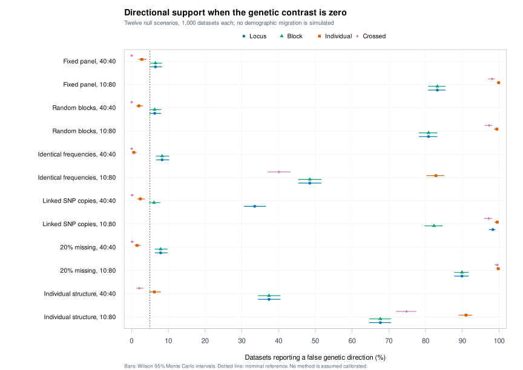
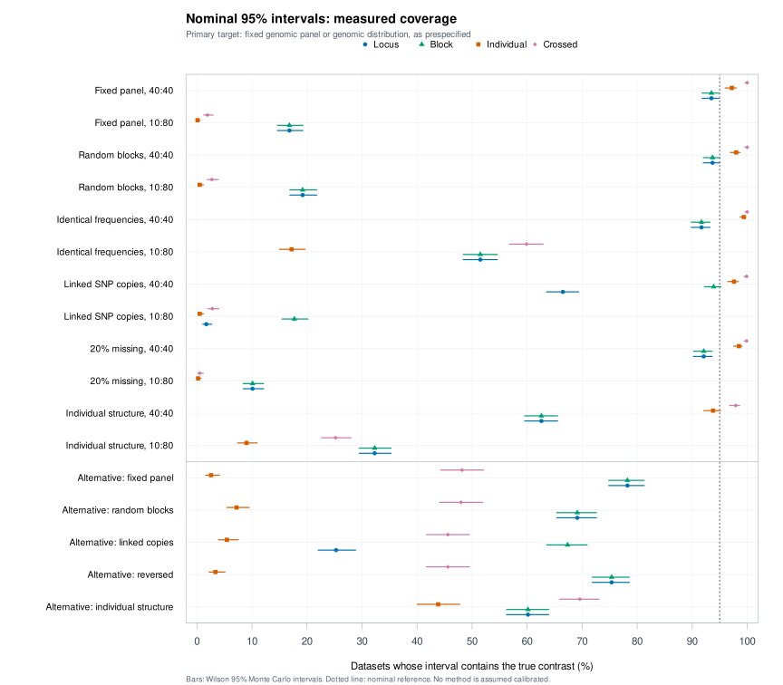

# Sampling uncertainty: prospective evaluation results

**The evaluation is complete, but calibrated directional support has not been
established.** All four resampling procedures failed the prespecified overall
screen. The results reveal strong finite-sample bias under unequal sampling,
linkage-induced pseudoreplication, and sensitivity to correlation across loci
within individuals. Individual resampling alone did not solve these problems.

This study tests a **genetic contrast with known truth**, not a demographic
migration rate. The data are wholly synthetic. These findings are additional
to the demographic confounding shown in the earlier simulation pilots.

## Design and completeness

The [protocol](PROTOCOL.md), [settings](protocol-v1.json), and tested research
engine were publicly frozen at
[`7e8fd2f`](https://github.com/codewithPauline/snpflowR/commit/7e8fd2f660d595b5edd34813a04909c9d57ff3db)
before evaluation seeds were run. This is an internal prospective evaluation,
not an external preregistration or independent expert review.

- **17 scenarios, 15,125 datasets, 60,500 method outcomes.**
- Twelve genetic-null scenarios have 1,000 datasets each; five alternatives
  have 625 each. Each method uses 999 bootstrap draws and nominal 95% intervals.
- Four methods: locus, block, individual, and crossed individual/block resampling.
- Genomic panels contain 80 independent blocks with one or four identical SNP
  copies per block. Individuals are sampled at 40:40 or 10:80.
- Conditions include fixed/random genomic panels, identical population
  frequencies, complete within-block linkage, 20% missing calls, and a latent
  individual effect inducing correlation across loci.
- **No execution failures or undefined intervals occurred.** No dataset was
  discarded, substituted, or selected because it gave a favorable answer.

Coverage is assessed against the exact latent-frequency contrast: the realized
panel for fixed-panel scenarios, or the analytically known genomic-distribution
contrast for random-panel scenarios. Secondary realized-panel coverage is also
retained. These targets differ from an expected statistic computed from noisy
sample frequencies, and neither is a migration parameter.

## Directional support under a true zero contrast

Selected diagnostic conditions are below; [complete tables with Wilson
95% Monte Carlo intervals](results/tables.md) include every scenario.
Each cell is the percentage reporting a nonzero direction among 1,000 datasets.

| Genetic-null condition | Locus | Block | Individual | Crossed |
|---|---:|---:|---:|---:|
| Fixed panel, samples 40:40 | 6.5% | 6.5% | 2.8% | 0.0% |
| Fixed panel, samples 10:80 | 83.2% | 83.2% | 99.9% | 98.1% |
| Four linked SNP copies, samples 40:40 | 33.5% | 6.1% | 2.4% | 0.1% |
| Individual structure, samples 40:40 | 37.4% | 37.4% | 6.2% | 2.1% |
| Identical frequencies, samples 10:80 | 48.5% | 48.5% | 82.8% | 40.1% |

For example, block resampling's 83.2% false-support rate under fixed-panel
unequal sampling has a Wilson interval of **80.8%-85.4%**. In the linked,
balanced case, treating SNP copies as independent gives **33.5% [30.6%,36.5%]**,
versus **6.1% [4.8%,7.8%]** when whole blocks are resampled. These are rates for
the specified synthetic conditions, not estimated rates for all SNP datasets.



## Coverage and sign recovery are distinct

Nominal 95% intervals often missed the true contrast. In the fixed-panel
alternative, all methods recovered and supported the correct sign in all
625 datasets, while coverage was:

| Method | True contrast covered | Coverage | Wilson 95% Monte Carlo interval |
|---|---:|---:|---:|
| Locus | 489/625 | 78.24% | 74.84%-81.30% |
| Block | 489/625 | 78.24% | 74.84%-81.30% |
| Individual | 16/625 | 2.56% | 1.58%-4.12% |
| Crossed | 301/625 | 48.16% | 44.27%-52.08% |

All five alternatives had correct supported signs in 625/625 datasets per
method, with zero wrong or unresolved labels. That limited sign-recovery result
coexists with poor coverage and high false support in null conditions.



The individual bootstrap was conservative in several balanced null conditions,
and crossed resampling sometimes covered the null in nearly every dataset.
Those cases do not establish 95% calibration. The prospective screen requires
the entire Wilson coverage interval to lie within 92.5%-97.5%, and the upper
Wilson false-support bound to be at most 7.5% in each null condition. This is
stricter than a coverage point estimate close to 95%, and is a practical screen,
not a formal equivalence test.

| Method | Coverage scenarios meeting screen | Null support scenarios meeting screen | Overall screen |
|---|---:|---:|---|
| Locus | 0/17 | 0/12 | Failed |
| Block | 0/17 | 0/12 | Failed |
| Individual | 0/17 | 5/12 | Failed |
| Crossed | 0/17 | 6/12 | Failed |

## What the diagnostics show

**Finite-sample bias is substantial under imbalance.** In the fixed-panel
10:80 null, the mean estimated contrast is about 0.03396 although truth is
exactly zero; its empirical SD is about 0.01545. Resampling changes uncertainty
estimates but leaves the original point estimator unchanged. A percentile
bootstrap can itself shift further in the same direction.

For illustration, the first fixed-panel alternative has true contrast
0.00406375 and observed estimate 0.00621666. The individual bootstrap mean is
0.00794245, with interval 0.00599290-0.01060807, which misses truth. This
post-evaluation diagnostic is retained in the literal replay record; it was
not used to select or tune a replacement method.

**The resampling unit matters.** Whole blocks prevent the exaggerated precision
from treating four identical SNP copies as independent. Whole individuals help
capture dependence shared across their loci. Independently resampling both
crossed factors can be conservative, and does not remove bias in this nonlinear
statistic. This experiment therefore provides no basis for simply replacing
the existing bootstrap with the individual or crossed prototype.

## Verification and preserved evidence

Before evaluation, research-engine tests checked weighted resampling against
literal row/column duplication, missing data, allele/population reversal, an
independent heterozygosity oracle, and the package's support rule.

After seeing the failures, four scenarios' first datasets were audited by
replaying **all 999 draws for all four methods** through literal R duplication
and the public package functions: **15,984 reference draws**. The largest
difference from the C++ research engine was 2.09e-16 (rounded upward), and all
stored endpoints agreed within 1e-12. This is a computational check, not an
additional performance study. [Replay results](results/literal-replay-check.csv).

A separate Python checker revalidated all **60,500** archived method outcomes,
their seed schedules, coverage indicators, directional labels, and the Wilson
summary limits. [Verification record](results/summary-verification.json).

All seven GitHub software jobs passed for result revision `32426ed`, including
five platform checks, the pinned comparator audit, and the new research-engine
smoke workflow. The local package check had zero errors or warnings and one
development-version note. [Software verification record](../SOFTWARE_CHECKS.md).
These software passes do not change the failed scientific calibration screen.

All 17 raw CSVs are preserved in [replicates.zip](results/replicates.zip), with
[SHA-256 checksums and row counts](results/replicate-archive-manifest.json).
The archive preserves the original CSV bytes. It is compact storage, not a
filtered selection. Additional records include:

- [Full summary CSV](results/summary.csv), including bias, interval width,
  conditional/unconditional coverage, uncertainty, and undefined counts.
- [Paired method differences](results/paired-comparisons.csv), with Monte Carlo
  SE calculated from paired indicators rather than assuming independent methods.
- [Completion manifest](results/completion.json) and
  [frozen source checksums and launch record](results/evaluation-manifest.json).
- Per-scenario timing, per-batch resource records, and four R session records
  in [results/](results/).

The four concurrent batches took approximately 65-124 seconds each in this
environment, including compilation, with peak child-process RSS about 399 MiB
per batch. This is not a broad performance benchmark; peak RSS is not total
memory across concurrent workers. The collapsed engine exploits equal-sized,
exactly duplicated SNP blocks and is not a general-purpose VCF implementation.

## Reproduce

The research dependencies are Rcpp, jsonlite, a C++ toolchain, Python 3, and an
installed snpflowR. They are not new runtime dependencies of the package.

Reanalyze the saved outcomes without regenerating data:

```sh
python3 -m zipfile -e validation/uncertainty/results/replicates.zip validation/uncertainty/results
Rscript validation/uncertainty/summarise.R evaluation
python3 validation/uncertainty/validate_summary.py
Rscript validation/uncertainty/plot_results.R
```

Regenerate the study from a fresh checkout with no extracted per-scenario CSVs:

```sh
R CMD INSTALL .
Rscript validation/uncertainty/check_engine.R
python3 validation/uncertainty/run_batch.py evaluation
Rscript validation/uncertainty/summarise.R evaluation
python3 validation/uncertainty/archive_results.py
python3 validation/uncertainty/validate_summary.py
```

Existing complete scenario CSVs are verified as checkpoints and skipped. Source
fingerprints must match; the runner refuses to silently resume a changed study.
The `Uncertainty-engine` workflow runs deterministic checks and all 17 small
smoke scenarios with separate development seeds, not the full evaluation grid.

## Decision and remaining work

No new inference method or threshold is promoted. The public estimator retains
its numerical behavior and now records `calibration_status = "not_established"`
in provenance and states that its intervals are nominal when printed.

The next development experiments should address point-estimator bias and
sampling imbalance explicitly, compare appropriately justified bias corrections
and balanced-sampling strategies, and investigate nonregular zero-differentiation
cases. Any proposed improvement requires a new protocol and fresh evaluation
seeds. Reusing these outcomes to tune and then certify a method would be invalid.

Only two populations, four frequency types, one block count, equal block sizes,
simple missingness, and a controlled row-dependency model were tested. General
LD, genotype error, sample relatedness, ascertainment, multiple comparisons,
realistic demography, and empirical data remain open. Independent scientific
review is still required. [Protocol and primary references](PROTOCOL.md).
